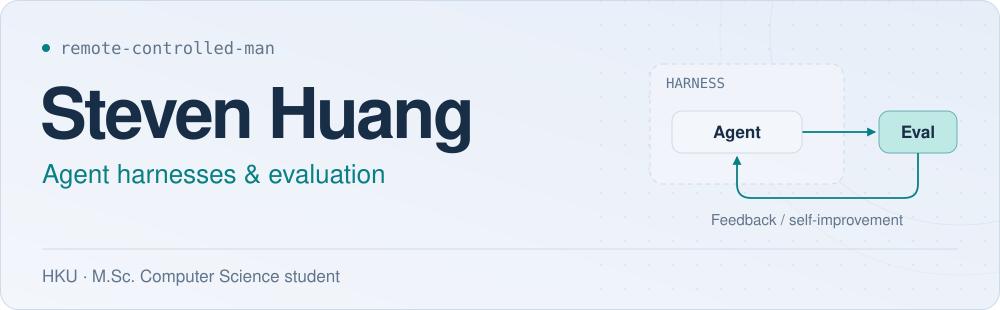

<picture><source media="(prefers-color-scheme: dark) and (max-width: 900px)" srcset="./assets/hero-harness-en-mobile-dark-v3.svg"><source media="(max-width: 900px)" srcset="./assets/hero-harness-en-mobile-light-v3.svg"><source media="(prefers-color-scheme: dark)" srcset="./assets/hero-harness-en-dark-v3.svg"></picture>

  <a href="./README.zh-CN.md"><picture><source media="(prefers-color-scheme: dark)" srcset="./assets/button-nav-language-en-dark-v2.svg"></picture></a>&nbsp;&nbsp;<a href="#user-content-projects"><picture><source media="(prefers-color-scheme: dark)" srcset="./assets/button-nav-projects-en-dark-v2.svg"></picture></a>
  <a href="#user-content-open-source-contributions"><picture><source media="(prefers-color-scheme: dark)" srcset="./assets/button-nav-contributions-en-dark-v2.svg"></picture></a>&nbsp;&nbsp;<a href="https://www.linkedin.com/in/steven-sidi-huang/"><picture><source media="(prefers-color-scheme: dark)" srcset="./assets/button-nav-linkedin-en-dark-v2.svg"></picture></a>

I'm a master's student in Computer Science at the University of Hong Kong, currently interning at [Ant Group](https://www.antgroup.com/) on AI for quantitative research. I build agents that turn existing factors into trading strategies and backtest them, and I'm exploring how they can use backtesting feedback to discover new factors. Previously, I worked on agent evaluation, harnesses, and full-duplex multimodal interaction at [Cybopal](https://cybopal.com/), and interned at [Kuaishou](https://www.kuaishou.com/).

## Projects

<table>
<tr><td width="100%">
<h3><a href="https://github.com/remote-controlled-man/skillfit">skillfit ↗</a></h3>

A CLI for paired A/B tests of Skills, rules files, and MCP setups. Measures task quality, trigger behavior, and token cost, with replayable records and evaluation budgets. Available on npm.

<a href="https://github.com/remote-controlled-man/skillfit/blob/main/benches/contrib/oss-mcp-use-utf8/README.md">Case study</a> &nbsp;·&nbsp; <a href="https://github.com/remote-controlled-man/skillfit/blob/main/docs/metrics.md">Methodology</a>

</td></tr>
</table>

<table>
<tr><td width="100%">
<h3><a href="https://github.com/remote-controlled-man/device-agent-arena">DeviceAgent Arena ↗</a></h3>

A testbed for stateful Chinese tool use, with state simulation, fault injection, and final-state and trajectory grading. Studies post-training and closed-loop execution through small-model proposals, validation, and planner fallback.

<a href="https://github.com/remote-controlled-man/device-agent-arena/blob/main/docs/V2_7_LAYERED_EXPERIMENT_REPORT.md">Experiment report</a> &nbsp;·&nbsp; <a href="https://github.com/remote-controlled-man/device-agent-arena/blob/main/docs/REPRODUCING_V2_7.md">Reproduce</a>

</td></tr>
</table>

<strong>Notes</strong> &nbsp;·&nbsp; <a href="https://github.com/remote-controlled-man/llm-paper-wiki">LLM Paper Wiki</a> &nbsp;·&nbsp; <a href="https://remote-controlled-man.github.io/agent-context-memory-guide/">Agent Context &amp; Memory Guide</a> (earlier reading)

## Open-source contributions

**35 merged PRs · 12 upstream projects** &nbsp; As of 2026-10-18

| Selected projects | PRs | Selected contributions |
| :--- | :---: | :--- |
| [AxonHub](https://github.com/looplj/axonhub)  LLM API gateway | [12](https://github.com/looplj/axonhub/pulls?q=is%3Apr+is%3Amerged+author%3Aremote-controlled-man) | Fixed tool-call/output ordering and audio-response detection across API conversions. [#2633](https://github.com/looplj/axonhub/pull/2633) [#2634](https://github.com/looplj/axonhub/pull/2634) |
| [AgentField](https://github.com/Agent-Field/agentfield)  Agent backend framework | [7](https://github.com/Agent-Field/agentfield/pulls?q=is%3Apr+is%3Amerged+author%3Aremote-controlled-man) | Added harness preflight checks; corrected memory and cost reporting in the Python SDK. [#1069](https://github.com/Agent-Field/agentfield/pull/1069) [#1106](https://github.com/Agent-Field/agentfield/pull/1106) |
| [FastMCP](https://github.com/punkpeye/fastmcp)  TypeScript MCP server framework | [3](https://github.com/punkpeye/fastmcp/pulls?q=is%3Apr+is%3Amerged+author%3Aremote-controlled-man) | Added OpenAPI object-path parameters; fixed required JSON bodies and stdio shutdown. [#433](https://github.com/punkpeye/fastmcp/pull/433) [#434](https://github.com/punkpeye/fastmcp/pull/434) |
| [OpenLIT](https://github.com/openlit/openlit)  Agent observability and evaluation | [1](https://github.com/openlit/openlit/pulls?q=is%3Apr+is%3Amerged+author%3Aremote-controlled-man) | Added OpenCode integration with lifecycle telemetry, token/cost accounting, and bounded event delivery. [#1591](https://github.com/openlit/openlit/pull/1591) |
| [MCP-Use](https://github.com/mcp-use/mcp-use)  MCP application framework | [1](https://github.com/mcp-use/mcp-use/pulls?q=is%3Apr+is%3Amerged+author%3Aremote-controlled-man) | Fixed UTF-8 decoding of MCP App HTML so Chinese text and emoji render correctly. [#2632](https://github.com/mcp-use/mcp-use/pull/2632) |
| [Vibe-Trading](https://github.com/HKUDS/Vibe-Trading)  AI trading agent | [2](https://github.com/HKUDS/Vibe-Trading/pulls?q=is%3Apr+is%3Amerged+author%3Aremote-controlled-man) | Aligned options-pricing volatility with bar cadence and fixed trade-journal format detection. [#1753](https://github.com/HKUDS/Vibe-Trading/pull/1753) [#1766](https://github.com/HKUDS/Vibe-Trading/pull/1766) |
| [CopilotKit](https://github.com/CopilotKit/CopilotKit)  Frontend framework for agents | [1](https://github.com/CopilotKit/CopilotKit/pulls?q=is%3Apr+is%3Amerged+author%3Aremote-controlled-man) | Fixed runtime route-boundary checks for requests with similar path prefixes. [#7341](https://github.com/CopilotKit/CopilotKit/pull/7341) |
| [GPT&nbsp;Researcher](https://github.com/assafelovic/gpt-researcher)  Autonomous research agent | [2](https://github.com/assafelovic/gpt-researcher/pulls?q=is%3Apr+is%3Amerged+author%3Aremote-controlled-man) | Fixed research-context merging and fallback for empty retrieval results. [#2104](https://github.com/assafelovic/gpt-researcher/pull/2104) |

View all 35 merged PRs across 12 projects

PR counts verified on 2026-10-18. Star badges show dynamically updated upstream repository stars.

**[AxonHub](https://github.com/looplj/axonhub) · 12 merged**

- [#2634](https://github.com/looplj/axonhub/pull/2634) — Recognized message audio as response content, preventing unnecessary empty-response retries.
- [#2633](https://github.com/looplj/axonhub/pull/2633) — Kept tool outputs adjacent to their calls when converting Responses API input.
- [#2572](https://github.com/looplj/axonhub/pull/2572) — Placed aggregated citations in the top-level response field without leaking transformer metadata.
- [#2561](https://github.com/looplj/axonhub/pull/2561) — Preserved refusal, audio, logprobs, and reasoning when aggregating chat streams.
- [#2519](https://github.com/looplj/axonhub/pull/2519) — Preserved allowed-tool restrictions across Chat Completions routes.
- [#2517](https://github.com/looplj/axonhub/pull/2517) — Kept the template popover scrollable inside the profiles dialog.
- [#2501](https://github.com/looplj/axonhub/pull/2501) — Preserved the User-Agent required by providers on outbound requests.
- [#2499](https://github.com/looplj/axonhub/pull/2499) — Used the inbound request body when applying set_if_absent overrides.
- [#2484](https://github.com/looplj/axonhub/pull/2484) — Corrected embedded fixture paths for the filesystem API.
- [#2423](https://github.com/looplj/axonhub/pull/2423) — Preserved DeepSeek native web-search tools in Anthropic request handling.
- [#2414](https://github.com/looplj/axonhub/pull/2414) — Mapped reasoning_effort: none to Bailian's thinking-disable option.
- [#2370](https://github.com/looplj/axonhub/pull/2370) — Accepted application/json for image-edit requests in passthrough mode.

**[AgentField](https://github.com/Agent-Field/agentfield) · 7 merged**

- [#1106](https://github.com/Agent-Field/agentfield/pull/1106) — Fixed missing-key detection in memory.exists() while preserving stored falsy values.
- [#1105](https://github.com/Agent-Field/agentfield/pull/1105) — Reported provider-confirmed zero cost as known instead of unknown.
- [#1100](https://github.com/Agent-Field/agentfield/pull/1100) — Made unrecognized async environment flags fall back to the actual class defaults.
- [#1082](https://github.com/Agent-Field/agentfield/pull/1082) — Aligned AGENTFIELD_ASYNC boolean parsing with the repository's environment-variable conventions.
- [#1078](https://github.com/Agent-Field/agentfield/pull/1078) — Prevented rate-limiter jitter from changing the global random state.
- [#1072](https://github.com/Agent-Field/agentfield/pull/1072) — Skipped schema output directories when harness runs do not use a schema.
- [#1069](https://github.com/Agent-Field/agentfield/pull/1069) — Added provider availability checks before TypeScript agent harness runs.

**[FastMCP](https://github.com/punkpeye/fastmcp) · 3 merged**

- [#442](https://github.com/punkpeye/fastmcp/pull/442) — Sent an empty JSON object for required request bodies when no properties are supplied.
- [#434](https://github.com/punkpeye/fastmcp/pull/434) — Closed framework-owned stdio sessions and transports on stop, including cancellation and setup-failure cleanup.
- [#433](https://github.com/punkpeye/fastmcp/pull/433) — Added OpenAPI simple-style serialization for flat object path parameters.

**[OpenLIT](https://github.com/openlit/openlit) · 1 merged**

- [#1591](https://github.com/openlit/openlit/pull/1591) — Added OpenCode integration with lifecycle telemetry, token/cost accounting, and bounded non-blocking event delivery.

**[MCP-Use](https://github.com/mcp-use/mcp-use) · 1 merged**

- [#2632](https://github.com/mcp-use/mcp-use/pull/2632) — Decoded MCP App HTML blobs as UTF-8 so Chinese text and emoji render correctly.

**[Vibe-Trading](https://github.com/HKUDS/Vibe-Trading) · 2 merged**

- [#1766](https://github.com/HKUDS/Vibe-Trading/pull/1766) — Corrected Futu journal format detection so generic column aliases do not silently zero out fills.
- [#1753](https://github.com/HKUDS/Vibe-Trading/pull/1753) — Annualized options-pricing volatility using the backtest's actual bar cadence.

**[CopilotKit](https://github.com/CopilotKit/CopilotKit) · 1 merged**

- [#7341](https://github.com/CopilotKit/CopilotKit/pull/7341) — Enforced base-path segment boundaries in single-route runtime matching.

**[GPT Researcher](https://github.com/assafelovic/gpt-researcher) · 2 merged**

- [#2105](https://github.com/assafelovic/gpt-researcher/pull/2105) — Fell back when retriever content became blank after normalization.
- [#2104](https://github.com/assafelovic/gpt-researcher/pull/2104) — Preserved complementary web-research context when combining sources.

**[MCPHub](https://github.com/samanhappy/mcphub) · 2 merged**

- [#1315](https://github.com/samanhappy/mcphub/pull/1315) — Matched both Windows and POSIX paths in the jose test transform so affected suites can load.
- [#1314](https://github.com/samanhappy/mcphub/pull/1314) — Fixed MCPB installation on Windows by keeping the rename destination absent before moving the extracted bundle.

**[DeepTutor](https://github.com/HKUDS/DeepTutor) · 1 merged**

- [#1588](https://github.com/HKUDS/DeepTutor/pull/1588) — Recognized vision support in Gemini model IDs with a models/ prefix.

**[PR-Agent](https://github.com/The-PR-Agent/pr-agent) · 1 merged**

- [#3639](https://github.com/The-PR-Agent/pr-agent/pull/3639) — Created a missing changelog file when publishing generated updates.

**[Agent-For-Exam](https://github.com/1firecracker/Agent-For-Exam) · 2 merged**

- [#15](https://github.com/1firecracker/Agent-For-Exam/pull/15) — Applied global styles to teleported settings dialogs on mobile.
- [#14](https://github.com/1firecracker/Agent-For-Exam/pull/14) — Adapted the LLM settings dialog and PPT touch controls for Android.

[View the full history on GitHub →](https://github.com/search?q=is%3Apr+is%3Amerged+author%3Aremote-controlled-man+-user%3Aremote-controlled-man&type=pullrequests)

