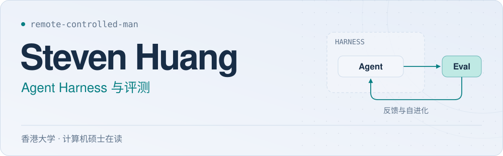

<picture><source media="(prefers-color-scheme: dark) and (max-width: 900px)" srcset="./assets/hero-harness-zh-mobile-dark-v3.svg"><source media="(max-width: 900px)" srcset="./assets/hero-harness-zh-mobile-light-v3.svg"><source media="(prefers-color-scheme: dark)" srcset="./assets/hero-harness-zh-dark-v3.svg"></picture>

  <a href="./README.md"><picture><source media="(prefers-color-scheme: dark)" srcset="./assets/button-nav-language-zh-dark-v2.svg"></picture></a>&nbsp;&nbsp;<a href="#user-content-项目"><picture><source media="(prefers-color-scheme: dark)" srcset="./assets/button-nav-projects-zh-dark-v2.svg"></picture></a>
  <a href="#user-content-开源贡献"><picture><source media="(prefers-color-scheme: dark)" srcset="./assets/button-nav-contributions-zh-dark-v2.svg"></picture></a>&nbsp;&nbsp;<a href="https://www.linkedin.com/in/steven-sidi-huang/"><picture><source media="(prefers-color-scheme: dark)" srcset="./assets/button-nav-linkedin-zh-dark-v2.svg"></picture></a>

我在香港大学读计算机硕士，目前在[蚂蚁集团](https://www.antgroup.com/)实习，做 AI + 量化。我负责让 Agent 从已有因子生成策略、跑回测，最近也在研究让它根据回测反馈挖掘新的因子。之前在[细胞壁（Cybopal）](https://cybopal.com/)做 Agent 评测、Harness 和全双工多模态交互研究，也在[快手](https://www.kuaishou.com/)实习过。

## 项目

<table>
<tr><td width="100%">
<h3><a href="https://github.com/remote-controlled-man/skillfit">skillfit ↗</a></h3>

用配对 A/B 实验比较 Skill、规则文件与 MCP 配置的实际效果，记录任务质量、触发率和 Token 成本。支持预算控制与结果回放，可从 npm 安装。

<a href="https://github.com/remote-controlled-man/skillfit/blob/main/benches/contrib/oss-mcp-use-utf8/README.md">复现案例</a> &nbsp;·&nbsp; <a href="https://github.com/remote-controlled-man/skillfit/blob/main/docs/metrics.md">评测方法</a>

</td></tr>
</table>

<table>
<tr><td width="100%">
<h3><a href="https://github.com/remote-controlled-man/device-agent-arena">DeviceAgent Arena ↗</a></h3>

中文多轮工具调用的评测与后训练实验环境，包含状态模拟、故障注入、终态与轨迹评分。通过小模型提议、校验和 Planner 回退，研究 Agent 的闭环执行。

<a href="https://github.com/remote-controlled-man/device-agent-arena/blob/main/docs/V2_7_LAYERED_EXPERIMENT_REPORT.md">实验报告</a> &nbsp;·&nbsp; <a href="https://github.com/remote-controlled-man/device-agent-arena/blob/main/docs/REPRODUCING_V2_7.md">复现指南</a>

</td></tr>
</table>

<strong>笔记</strong> &nbsp;·&nbsp; <a href="https://github.com/remote-controlled-man/llm-paper-wiki">LLM Paper Wiki</a> &nbsp;·&nbsp; <a href="https://remote-controlled-man.github.io/agent-context-memory-guide/">Agent Context &amp; Memory Guide</a> （早期阅读）

## 开源贡献

**35 个已合并 PR · 12 个上游项目** &nbsp; 截至 2026-10-18

| 精选项目 | PR | 代表贡献 |
| :--- | :---: | :--- |
| [AxonHub](https://github.com/looplj/axonhub)  LLM API 网关 | [12](https://github.com/looplj/axonhub/pulls?q=is%3Apr+is%3Amerged+author%3Aremote-controlled-man) | 修复 API 转换中的工具调用与结果顺序，以及音频响应的有效内容判断。 [#2633](https://github.com/looplj/axonhub/pull/2633) [#2634](https://github.com/looplj/axonhub/pull/2634) |
| [AgentField](https://github.com/Agent-Field/agentfield)  Agent 后端框架 | [7](https://github.com/Agent-Field/agentfield/pulls?q=is%3Apr+is%3Amerged+author%3Aremote-controlled-man) | 增加 Harness 运行前预检，修复 Python SDK 的记忆键判断与成本上报。 [#1069](https://github.com/Agent-Field/agentfield/pull/1069) [#1106](https://github.com/Agent-Field/agentfield/pull/1106) |
| [FastMCP](https://github.com/punkpeye/fastmcp)  TypeScript MCP 服务框架 | [3](https://github.com/punkpeye/fastmcp/pulls?q=is%3Apr+is%3Amerged+author%3Aremote-controlled-man) | 支持 OpenAPI 对象路径参数，修复必填 JSON 请求体与 stdio 会话关闭。 [#433](https://github.com/punkpeye/fastmcp/pull/433) [#434](https://github.com/punkpeye/fastmcp/pull/434) |
| [OpenLIT](https://github.com/openlit/openlit)  Agent 可观测性与评测 | [1](https://github.com/openlit/openlit/pulls?q=is%3Apr+is%3Amerged+author%3Aremote-controlled-man) | 增加 OpenCode 集成，接入生命周期遥测、Token 与成本统计及有界事件投递。 [#1591](https://github.com/openlit/openlit/pull/1591) |
| [MCP-Use](https://github.com/mcp-use/mcp-use)  MCP 应用框架 | [1](https://github.com/mcp-use/mcp-use/pulls?q=is%3Apr+is%3Amerged+author%3Aremote-controlled-man) | 修复 MCP App HTML 的 UTF-8 解码，让中文和 Emoji 正确显示。 [#2632](https://github.com/mcp-use/mcp-use/pull/2632) |
| [Vibe-Trading](https://github.com/HKUDS/Vibe-Trading)  AI 交易 Agent | [2](https://github.com/HKUDS/Vibe-Trading/pulls?q=is%3Apr+is%3Amerged+author%3Aremote-controlled-man) | 统一期权定价波动率与 K 线频率，修复交易日志格式误判。 [#1753](https://github.com/HKUDS/Vibe-Trading/pull/1753) [#1766](https://github.com/HKUDS/Vibe-Trading/pull/1766) |
| [CopilotKit](https://github.com/CopilotKit/CopilotKit)  Agent 前端框架 | [1](https://github.com/CopilotKit/CopilotKit/pulls?q=is%3Apr+is%3Amerged+author%3Aremote-controlled-man) | 修复 Runtime 路由边界判断，避免路径前缀相似的请求被误匹配。 [#7341](https://github.com/CopilotKit/CopilotKit/pull/7341) |
| [GPT&nbsp;Researcher](https://github.com/assafelovic/gpt-researcher)  自主研究 Agent | [2](https://github.com/assafelovic/gpt-researcher/pulls?q=is%3Apr+is%3Amerged+author%3Aremote-controlled-man) | 修复研究上下文合并与空检索结果回退，保留互补来源。 [#2104](https://github.com/assafelovic/gpt-researcher/pull/2104) |

展开全部 35 个已合并 PR · 12 个项目

统计核实于 2026-10-18。上表 Star 为上游仓库的动态计数。

**[AxonHub](https://github.com/looplj/axonhub) · 12 个 PR**

- [#2634](https://github.com/looplj/axonhub/pull/2634) — 将消息中的音频识别为有效响应内容，避免误判为空响应并重复重试。
- [#2633](https://github.com/looplj/axonhub/pull/2633) — 转换 Responses API 输入时，将工具结果紧邻对应调用，避免上游拒绝消息顺序。
- [#2572](https://github.com/looplj/axonhub/pull/2572) — 将聚合后的引用信息放入响应顶层字段，避免泄露内部转换元数据。
- [#2561](https://github.com/looplj/axonhub/pull/2561) — 聚合聊天流时保留拒绝回答、音频、logprobs 和推理字段。
- [#2519](https://github.com/looplj/axonhub/pull/2519) — 在 Chat Completions 请求转发中保留允许调用的工具范围。
- [#2517](https://github.com/looplj/axonhub/pull/2517) — 修复配置弹窗内模板浮层无法滚动的问题。
- [#2501](https://github.com/looplj/axonhub/pull/2501) — 保留上游服务要求的 User-Agent 请求头。
- [#2499](https://github.com/looplj/axonhub/pull/2499) — 应用 set_if_absent 请求体覆盖规则时使用原始入站请求体。
- [#2484](https://github.com/looplj/axonhub/pull/2484) — 修正内嵌测试数据的文件系统路径。
- [#2423](https://github.com/looplj/axonhub/pull/2423) — 在 Anthropic 请求处理中保留 DeepSeek 原生网页搜索工具。
- [#2414](https://github.com/looplj/axonhub/pull/2414) — 将标准 reasoning_effort: none 正确映射为百炼的关闭思考选项。
- [#2370](https://github.com/looplj/axonhub/pull/2370) — 让透传模式下的图像编辑接口接受 application/json 请求。

**[AgentField](https://github.com/Agent-Field/agentfield) · 7 个 PR**

- [#1106](https://github.com/Agent-Field/agentfield/pull/1106) — 修复 memory.exists() 对缺失键的判断，同时正确识别已存储的空值、零等假值。
- [#1105](https://github.com/Agent-Field/agentfield/pull/1105) — 将 Provider 确认的零成本正确记为已知费用，避免误报为成本未知。
- [#1100](https://github.com/Agent-Field/agentfield/pull/1100) — 让无法识别的异步布尔环境变量回退到实际类默认值，兼容子类配置。
- [#1082](https://github.com/Agent-Field/agentfield/pull/1082) — 统一 AGENTFIELD_ASYNC 布尔环境变量的解析规则。
- [#1078](https://github.com/Agent-Field/agentfield/pull/1078) — 避免限流器的随机抖动影响全局随机数状态。
- [#1072](https://github.com/Agent-Field/agentfield/pull/1072) — 在不使用 Schema 的 Harness 运行中跳过 Schema 输出目录。
- [#1069](https://github.com/Agent-Field/agentfield/pull/1069) — 为 TypeScript Agent Harness 增加运行前的 Provider 可用性检查。

**[FastMCP](https://github.com/punkpeye/fastmcp) · 3 个 PR**

- [#442](https://github.com/punkpeye/fastmcp/pull/442) — 修复必填 JSON 请求体在未传属性时被省略的问题，正确发送空对象。
- [#434](https://github.com/punkpeye/fastmcp/pull/434) — 停止服务时关闭框架持有的 stdio 会话与传输，覆盖取消执行和初始化失败时的清理。
- [#433](https://github.com/punkpeye/fastmcp/pull/433) — 为 OpenAPI 扁平对象路径参数增加 simple 风格的序列化支持。

**[OpenLIT](https://github.com/openlit/openlit) · 1 个 PR**

- [#1591](https://github.com/openlit/openlit/pull/1591) — 增加 OpenCode 集成，覆盖生命周期遥测、Token 与成本统计，以及有界非阻塞事件投递。

**[MCP-Use](https://github.com/mcp-use/mcp-use) · 1 个 PR**

- [#2632](https://github.com/mcp-use/mcp-use/pull/2632) — 使用 UTF-8 解码 MCP App HTML，让中文和 Emoji 正确显示。

**[Vibe-Trading](https://github.com/HKUDS/Vibe-Trading) · 2 个 PR**

- [#1766](https://github.com/HKUDS/Vibe-Trading/pull/1766) — 修正富途交易日志的格式识别，避免通用列名被误解析后将成交数量和金额静默归零。
- [#1753](https://github.com/HKUDS/Vibe-Trading/pull/1753) — 按照回测实际 K 线频率年化期权定价波动率，统一定价与指标的时间口径。

**[CopilotKit](https://github.com/CopilotKit/CopilotKit) · 1 个 PR**

- [#7341](https://github.com/CopilotKit/CopilotKit/pull/7341) — 修复单路由模式下仅路径前缀相同就被错误匹配的问题。

**[GPT Researcher](https://github.com/assafelovic/gpt-researcher) · 2 个 PR**

- [#2105](https://github.com/assafelovic/gpt-researcher/pull/2105) — 在检索内容规范化后为空时启用回退处理。
- [#2104](https://github.com/assafelovic/gpt-researcher/pull/2104) — 合并来源时保留补充网页检索上下文，避免文本被破坏。

**[MCPHub](https://github.com/samanhappy/mcphub) · 2 个 PR**

- [#1315](https://github.com/samanhappy/mcphub/pull/1315) — 让 jose 的测试转换规则兼容 Windows 与 POSIX 路径，修复相关测试无法加载的问题。
- [#1314](https://github.com/samanhappy/mcphub/pull/1314) — 修复 Windows 上 MCPB 安装的目录重命名失败，确保移动解压目录前目标路径不存在。

**[DeepTutor](https://github.com/HKUDS/DeepTutor) · 1 个 PR**

- [#1588](https://github.com/HKUDS/DeepTutor/pull/1588) — 修复带 models/ 前缀的 Gemini 模型 ID 的视觉能力识别。

**[PR-Agent](https://github.com/The-PR-Agent/pr-agent) · 1 个 PR**

- [#3639](https://github.com/The-PR-Agent/pr-agent/pull/3639) — 发布自动生成的更新日志时，支持创建尚不存在的目标文件。

**[Agent-For-Exam](https://github.com/1firecracker/Agent-For-Exam) · 2 个 PR**

- [#15](https://github.com/1firecracker/Agent-For-Exam/pull/15) — 修复移动端 Teleport 弹窗的全局样式覆盖。
- [#14](https://github.com/1firecracker/Agent-For-Exam/pull/14) — 适配 Android 端的模型设置弹窗和 PPT 触控操作。

[在 GitHub 查看完整记录 →](https://github.com/search?q=is%3Apr+is%3Amerged+author%3Aremote-controlled-man+-user%3Aremote-controlled-man&type=pullrequests)

